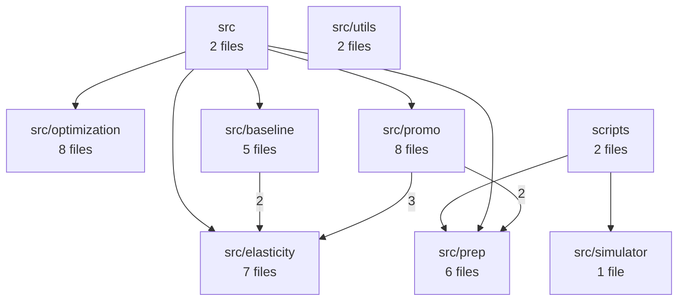

# Retail_price_optimization — Project Onboarding Guide

_Generated automatically by <a href='https://gnost.readthedocs.io'>GNOST</a>._

## Project Overview

- **Root:** `/Users/mohdzain/Documents/GitHub/Retail_price_optimization`
- **Languages:** python (71)
- **Framework:** Streamlit

## Summary Table

| Language | Files | LOC |
|---|---:|---:|
| Python | 132 | 13613 |

## Stats Table

| Language | Files | Code | Comments | Blanks | LOC |
|---|---:|---:|---:|---:|---:|
| Python | 132 | 11068 | 9 | 2536 | 13613 |

## Get it running

_Read from this project's own files. Each line names its source; nothing is guessed._

**Prerequisites**

- Python >=3.12,<3.13 _(pyproject.toml)_

**Install**

- `uv sync` _(pyproject.toml)_
- `make setup` _(Makefile)_
- `make install` _(Makefile)_

**Test**

- `pytest` _(pyproject.toml)_
- `make test` _(Makefile)_
- `make check` _(Makefile)_

**Environment variables**

- RPO_DEBUG _(.env.example)_
- RPO_PRINT_ENABLED _(.env.example)_

## Entry Points

- `scripts/check_data.py` — __main__ guard
- `scripts/check_pr_files.py` — __main__ guard
- `scripts/create_user.py` — __main__ guard
- `scripts/loc.py` — __main__ guard
- `src/pipeline.py` — __main__ guard

## Execution Flow (High Level)

- `scripts/check_data.py` → `src/config.py` → `src/schema.py`
- `scripts/check_data.py` → `src/config.py` → `src/utils/exceptions.py`
- `scripts/check_data.py` → `src/prep/__init__.py` → `src/prep/loader.py`
- `scripts/check_data.py` → `src/utils/__init__.py` → `src/utils/logger.py`
- `scripts/check_data.py` → `src/utils/__init__.py` → `src/utils/registry.py`

_(37 additional paths omitted for clarity.)_

## Execution Flow (Overview)

> Grouped by folder to stay readable: 9 folders; numbers on arrows count the file-level imports they stand for.
> Arrows into `src`, `src/utils` are not drawn: most folders import them, and drawing every arrow would hide the structure.

> 📌 This diagram shows the high-level execution flow. For the complete flow, see [**flow/flow-full.md**](./flow/FLOW-full.md) Raw Mermaid: [flow/flow-full.mmd](./flow/FLOW-full.mmd) Every file and import, ungrouped (for tools and AI): [flow/flow-complete.mmd](./flow/flow-complete.mmd) Interactive explorer: run `gnost open flow` (the page is `flow.html` in this folder; it is rebuilt, not committed)

## Recommended Reading Order

### Start Here

- `scripts/check_data.py`
- `scripts/check_pr_files.py`
- `scripts/create_user.py`
- `scripts/loc.py`
- `src/pipeline.py`

### Core Logic

- `src/baseline/__init__.py`
- `src/config.py`
- `src/elasticity/__init__.py`
- `src/optimization/__init__.py`
- `src/prep/__init__.py`
- `src/promo/__init__.py`
- `src/simulator/accounts.py`
- `src/utils/__init__.py`
- `src/baseline/service.py`
- `src/elasticity/base.py`
- `src/elasticity/bayes.py`
- `src/elasticity/frequentist.py`
- `src/elasticity/service.py`
- `src/elasticity/store.py`
- `src/optimization/service.py`
- _...and 23 more (closest to an entry point listed first)_

### Supporting / Leaf Code

- `scripts/check_pr_files.py`
- `scripts/loc.py`
- `src/schema.py`
- `src/utils/exceptions.py`
- `src/utils/logger.py`

## 📘 First Files to Read
- **`src/pipeline.py`**
  - Primary entry point into the application
- **`scripts/check_data.py`**
  - Primary entry point into the application
- **`scripts/create_user.py`**
  - Primary entry point into the application
- **`src/prep/__init__.py`**
  - Core logic file referenced by multiple execution paths
- **`src/utils/__init__.py`**
  - Core logic file referenced by multiple execution paths
- **`src/elasticity/__init__.py`**
  - Core logic file referenced by multiple execution paths
- **`src/optimization/__init__.py`**
  - Core logic file referenced by multiple execution paths
- **`src/promo/__init__.py`**
  - Core logic file referenced by multiple execution paths
- **`src/promo/service.py`**
  - Core logic file referenced by multiple execution paths
- **`src/optimization/service.py`**
  - Core logic file referenced by multiple execution paths

## ⚠️ Caution Areas
### `src/config.py`
- **Type:** high_impact
- **Severity:** 5
- **Caution score:** 81.3/100
- Imported by 35 files; 273 lines of code
### `src/schema.py`
- **Type:** high_impact
- **Severity:** 5
- **Caution score:** 81/100
- Imported by 41 files; 256 lines of code
### `src/utils/__init__.py`
- **Type:** high_impact
- **Severity:** 4
- **Caution score:** 80/100
- Imported by 32 files

## Change Hotspots

Files that changed most in the last 365 days (12 commits). A file that changes often and is touched by many people is where merge conflicts and regressions tend to start.

| File | Commits | Authors | Last 90 days | Lines changed | Last change |
|---|---:|---:|---:|---|---|
| `src/config.py` | 7 | 1 | 7 | +448 / -85 | 2026-11-27 |
| `src/pipeline.py` | 6 | 1 | 6 | +202 / -9 | 2026-11-27 |
| `src/schema.py` | 6 | 1 | 6 | +322 / -3 | 2026-11-27 |
| `src/plots/__init__.py` | 4 | 1 | 4 | +30 / -7 | 2026-11-27 |
| `src/elasticity/bayes.py` | 3 | 1 | 3 | +250 / -2 | 2026-11-27 |
| `src/utils/__init__.py` | 3 | 1 | 3 | +30 / -4 | 2026-11-27 |
| `src/utils/exceptions.py` | 3 | 1 | 3 | +42 / -1 | 2026-11-27 |
| `scripts/check_data.py` | 2 | 1 | 2 | +91 / -32 | 2026-11-26 |
| `src/__init__.py` | 2 | 1 | 2 | +9 / -1 | 2026-11-27 |
| `src/elasticity/__init__.py` | 2 | 1 | 2 | +27 / -2 | 2026-11-27 |
| `src/elasticity/base.py` | 2 | 1 | 2 | +147 / -0 | 2026-11-27 |
| `src/elasticity/service.py` | 2 | 1 | 2 | +183 / -0 | 2026-11-27 |
| `src/optimization/__init__.py` | 2 | 1 | 2 | +21 / -1 | 2026-11-27 |
| `src/optimization/problem.py` | 2 | 1 | 2 | +360 / -42 | 2026-11-27 |
| `src/optimization/robustness.py` | 2 | 1 | 2 | +80 / -4 | 2026-11-27 |

## Risky and Changing

Files that are fragile to change (high caution score) and also change often. Start here when adding tests or reviewing changes. Risk = caution score scaled by how much the file changes.

| File | Risk | Caution | Change activity | Why fragile | Commits | Authors |
|---|---:|---:|---:|---|---:|---:|
| `src/config.py` | 73.2 | 81.3 | 90 | many files depend on it, large file | 7 | 1 |
| `src/schema.py` | 68.7 | 81 | 84.8 | many files depend on it, large file | 6 | 1 |
| `src/utils/__init__.py` | 58.1 | 80 | 72.6 | many files depend on it | 3 | 1 |

## 🔁 Circular Dependencies

_No circular dependencies detected._
## Key Execution Paths

To understand specific scenarios, see the entry-based execution paths:

- 📍 [Entry-based Paths](flow/entry-paths.md)

- 🧭 [folder-based Paths](flow/folder-paths.md)

(Whole system: [flow/FLOW-full.md](flow/FLOW-full.md). For a small project it is the same as [flow/flow-complete.mmd](flow/flow-complete.mmd), every file and import; for a big one FLOW-full groups them by folder to stay readable. Interactive: `gnost open flow`.)

---

Generated by [GNOST](https://gnost.readthedocs.io) 0.7.1. Try it on your own code: `uvx gnost onboard .`
