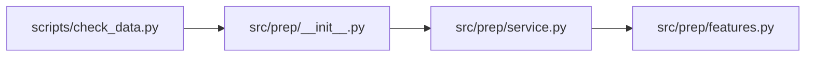
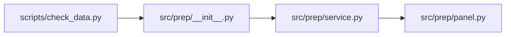
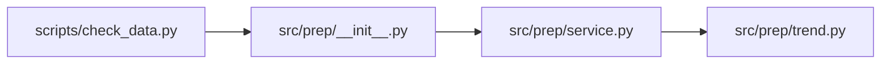

# Entry-based Execution Paths

These diagrams show individual execution paths starting from application entry points. Each path represents one possible flow through the system.

## Path 1 — `scripts/check_data.py`

**Execution chain:** scripts/check_data.py → src/prep/__init__.py → src/prep/service.py → src/prep/features.py

## Path 2 — `scripts/check_data.py`

**Execution chain:** scripts/check_data.py → src/prep/__init__.py → src/prep/service.py → src/prep/panel.py

## Path 3 — `scripts/check_data.py`

**Execution chain:** scripts/check_data.py → src/prep/__init__.py → src/prep/service.py → src/prep/trend.py

---

Generated by [GNOST](https://gnost.readthedocs.io) 0.7.1. Try it on your own code: `uvx gnost onboard .`
