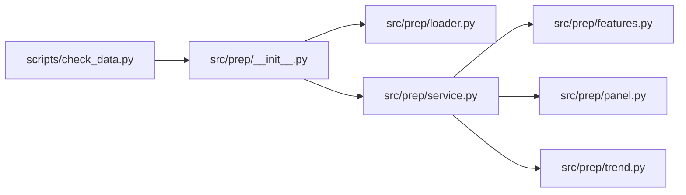
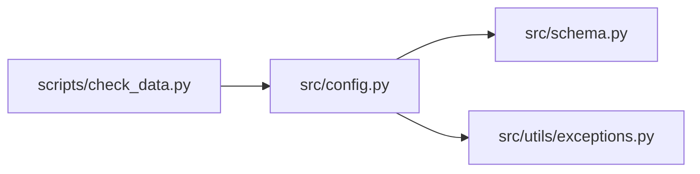
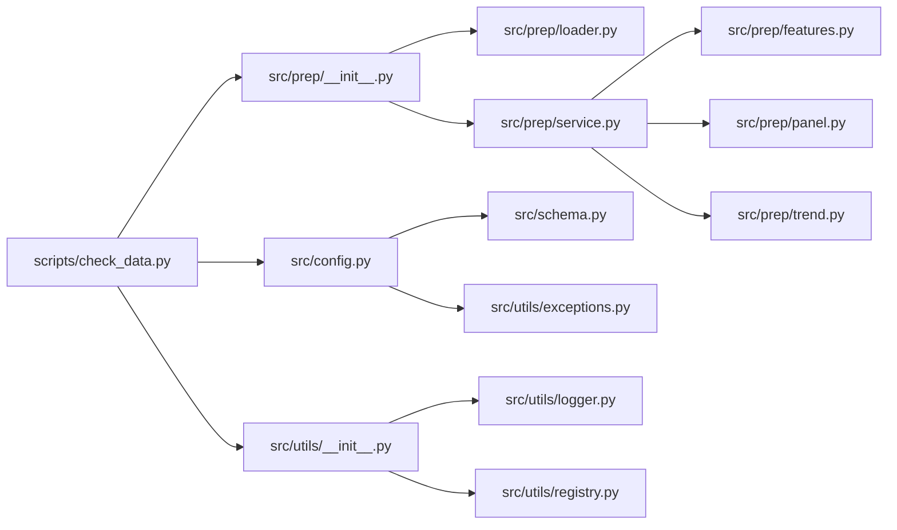
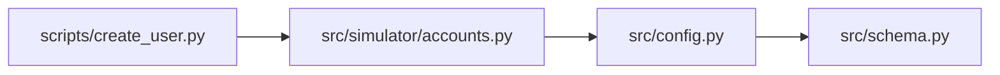
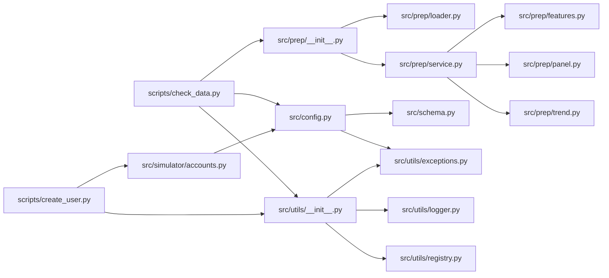
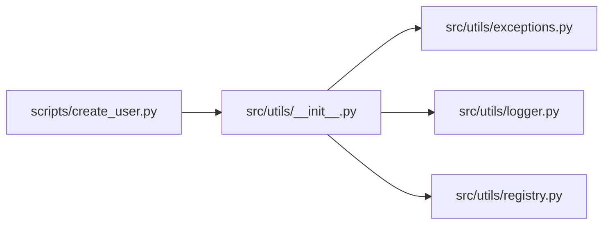
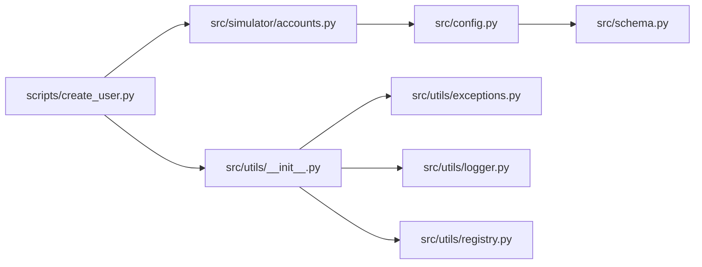

# Keyword-based Execution Paths

These diagrams show execution flows related to key features, auto-detected from the project structure.

## Feature: `data`

### Representative Paths

#### Path Group 1

**Execution chain:** scripts/check_data.py → src/prep/__init__.py → src/prep/service.py → src/prep/features.py

#### Path Group 2

**Execution chain:** scripts/check_data.py → src/config.py → src/schema.py

### Combined Flow (All `data` Paths)

## Feature: `scripts`

### Representative Paths

#### Path Group 1

**Execution chain:** scripts/check_data.py → src/prep/__init__.py → src/prep/service.py → src/prep/features.py

#### Path Group 2

**Execution chain:** scripts/create_user.py → src/simulator/accounts.py → src/config.py → src/schema.py

### Combined Flow (All `scripts` Paths)

## Feature: `user`

### Representative Paths

#### Path Group 1

**Execution chain:** scripts/create_user.py → src/simulator/accounts.py → src/config.py → src/schema.py

#### Path Group 2

**Execution chain:** scripts/create_user.py → src/utils/__init__.py → src/utils/exceptions.py

### Combined Flow (All `user` Paths)

---

Generated by [GNOST](https://gnost.readthedocs.io) 0.7.1. Try it on your own code: `uvx gnost onboard .`
