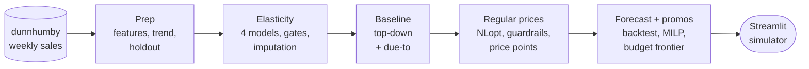
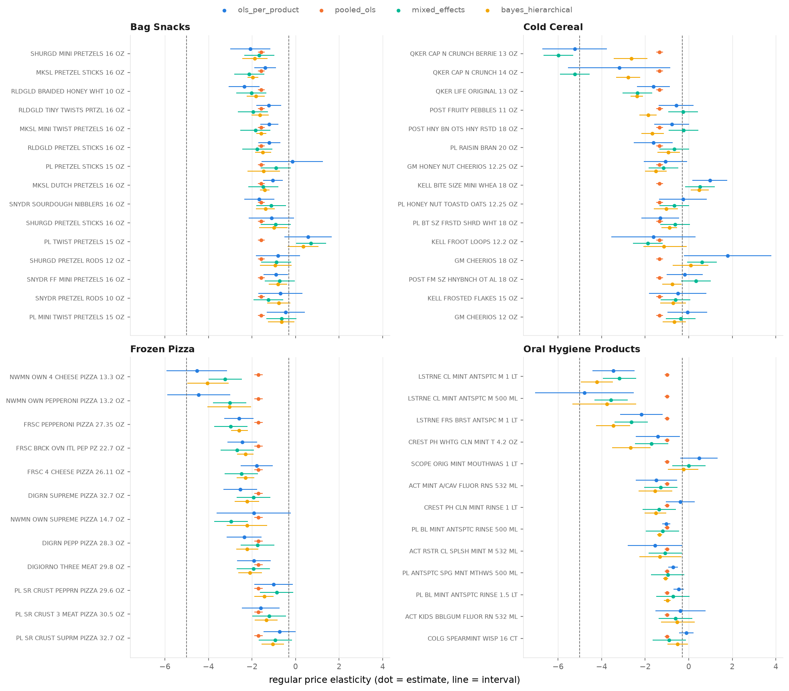
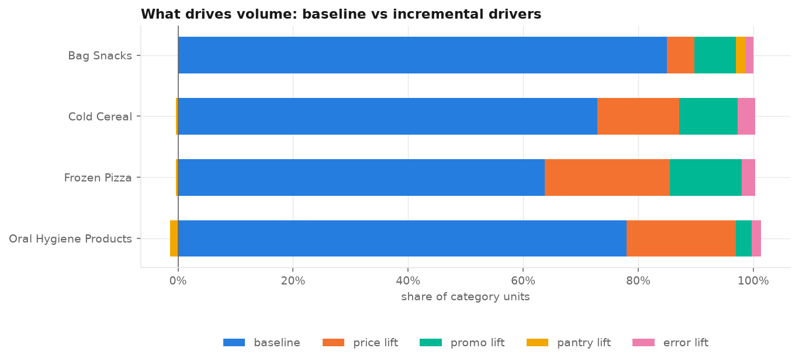
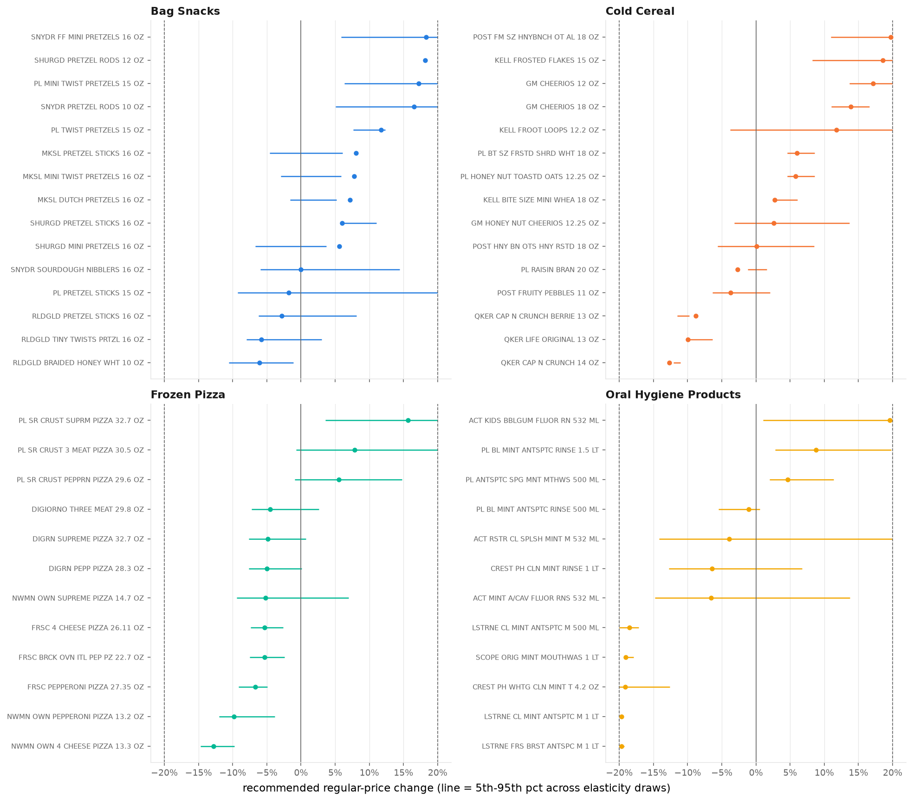
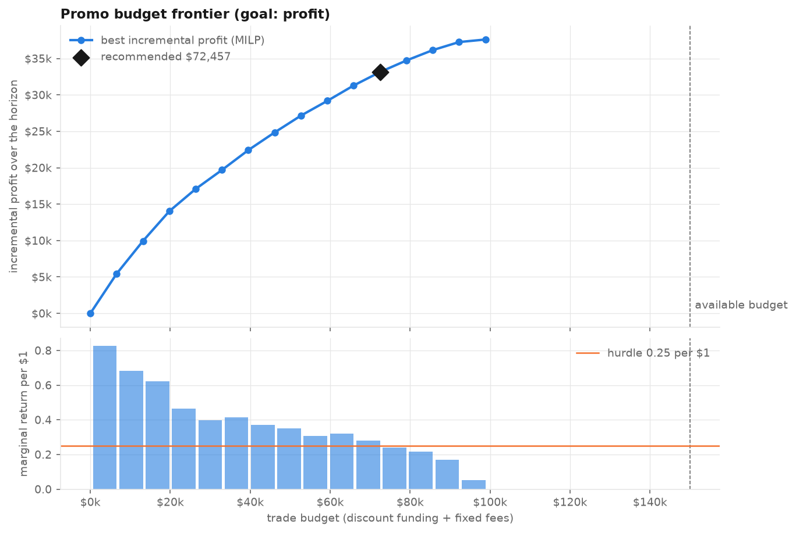
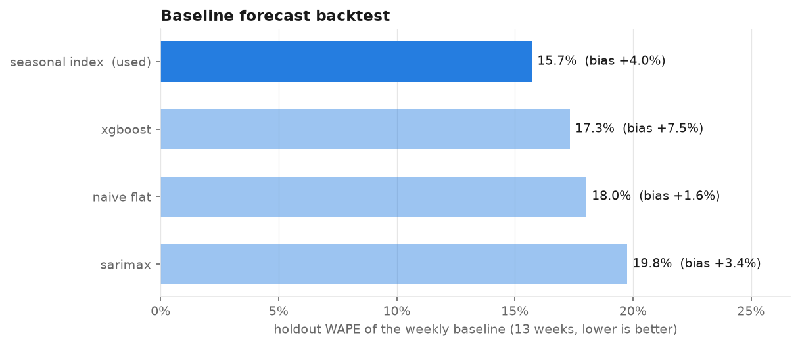
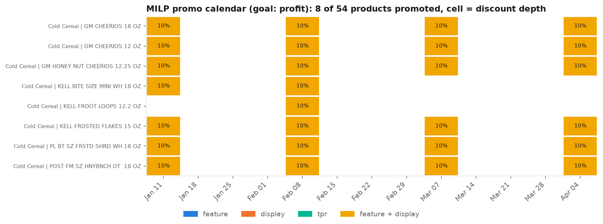
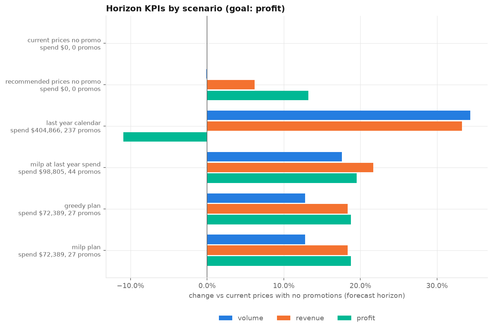

# Retail Price & Promo Optimization

[](docs/methodology.md)
[](docs/architecture.md)
[](docs/data.md)
<br>


[](LICENSE)


An end-to-end **Revenue Growth Management (RGM)** pipeline on dunnhumby's *Breakfast at the Frat* data: how
demand responds to price and promotions, what each product would sell without promotions, which regular prices to
set, and which promotions to run under a trade budget. A Streamlit simulator re-runs the optimizers live with your
own guardrails, margins, budget and rules.

## What it found

Weekly sales of 54 breakfast and snack products (cold cereal, bag snacks, frozen pizza, oral care) in 77 stores,
2009 to 2012. Costs are not in the data, so margins (28–40% by category) and promo fees are assumptions.

| Question                               | Answer on this dataset                                                                                                                                                                               |
| -------------------------------------- | ---------------------------------------------------------------------------------------------------------------------------------------------------------------------------------------------------- |
| Which elasticity model to trust?       | **Bayesian hierarchical**: lowest holdout error (WAPE 16.8% vs 17.9–19.1%), used for 43 of 55 products                                                                                               |
| How much volume is baseline?           | **75%**. Frozen pizza is the most promotion-dependent category (36% of volume is incremental)                                                                                                        |
| Regular prices for profit?             | **+12.9% weekly profit** (≈ +\$305k a year) at −0.2% volume, within ±20% moves and a +5% average cap                                                                                                 |
| Regular prices for revenue?            | +15.1% revenue, but **−18.9% profit**: chasing revenue cuts prices on elastic products                                                                                                               |
| Best baseline forecast?                | **Structural seasonal index**, WAPE 15.7%. It beats XGBoost (17.3%), naive (18.0%) and SARIMAX (19.8%)                                                                                               |
| How to promote, and how much to spend? | **\$72k** buys 27 promos, all feature + display at 10% off: with the new prices, **+18.7% profit** over 13 weeks vs today's prices and no promos. Last year's calendar spent \$405k and *lost* 10.9% |

## Key results

**Median elasticities by category** (final, guard-railed estimates for 55 products). The regular elasticity is the
response to a lasting shelf-price change; the promo elasticity is the response to a temporary discount.

| Category         | Regular price | Promo discount |
| ---------------- | ------------- | -------------- |
| Bag snacks       | −1.42         | −1.26          |
| Cold cereal      | −1.40         | −2.23          |
| Frozen pizza     | −2.22         | −2.40          |
| Oral hygiene     | −1.51         | −1.93          |
| **All products** | **−1.50**     | **−1.85**      |

Shoppers react more to temporary discounts than to lasting price changes in cereal, pizza and oral care. A single
price slope would blend the two.

**Profit goal: what prices and promotions each add** (13-week horizon, all 54 products, profit net of trade spend):

| Step                                                                     | Volume     | Revenue | Profit   | Change in profit                    |
| ------------------------------------------------------------------------ | ---------- | ------- | -------- | ----------------------------------- |
| Current prices, no promotions                                            | 630k units | \$1.92M | \$598.9k | baseline                            |
| + optimal regular prices (NLopt)                                         | 629k units | \$2.04M | \$678.1k | **+\$79.2k (+13.2%)**               |
| + optimal promotions (MILP, \$72.4k spend, 27 promos)                    | 710k units | \$2.27M | \$711.2k | **+\$33.1k more (+18.7% in total)** |
| *For reference: last year's promo calendar (\$404.9k spend, 237 promos)* | 846k units | \$2.56M | \$533.5k | −\$65.4k (−10.9%)                   |

Run all year, the price change alone is worth about **+\$305k profit** (+12.9% a week). The optimized promotions add
**\$177.7k more profit than last year's calendar** over the same 13 weeks, on 82% less trade spend.

**Revenue goal, for comparison** (same horizon):

| Step                                         | Revenue          | Profit            |
| -------------------------------------------- | ---------------- | ----------------- |
| + revenue-maximising regular prices          | \$2.21M (+15.0%) | \$484.8k (−19.1%) |
| + promotions (MILP, \$150k spend, 70 promos) | \$2.66M (+38.5%) | \$446.0k (−25.5%) |

Chasing revenue buys volume with lower prices and deeper promotions, and gives up a quarter of the profit. That is why
profit is the default goal.

## The pipeline



Each stage reads and writes `data/processed/`, so any step can be re-run on its own (`make <stage>`).

## Methodology in brief

The full reasoning, formulas, results and limitations are in [docs/methodology.md](docs/methodology.md).

**1 · Price elasticity.** A log-log demand model per product splits the price into a **regular** level and a
**promo** discount, so each product gets two elasticities: one for the optimizer, one for promo planning. Controls
cover feature, display and TPR shares, the post-promo dip (pantry loading), store coverage, holidays, Fourier
seasonality and a residual LOESS trend. Four models are compared: per-product OLS, pooled OLS, a mixed model, and a
**Bayesian hierarchical model** (PyMC) that pools products toward their category. Each product uses the first model
that passes quality gates (MAPE, R², sign and range), and products that fail every model are imputed from similar
products.

<p align="center"></p>

**2 · Baseline.** The baseline is what a product sells at its regular price with no promotion. It is built top-down:
actual log volume minus the model's price, promo, pantry and promo-week error effects. Implausible promo-week
baselines are repaired with bad-baseline rules (rolling mean). The incremental volume is split into price, promo,
pantry and error "due-to" lifts.

<p align="center"></p>

**3 · Regular prices (NLopt).** The goal is to maximise $\sum (P - c_{\text{eff}}) Q(P)$ on the constant-elasticity
curve, with $c_{\text{eff}} = c$ for profit and 0 for revenue. The constraints are:
- prices within ±20%;
- total volume ≥ 95% of today;
- revenue-weighted average increase ≤ 5%;
- branded products kept at least 10% above private label (per unit size).

SLSQP (with analytic gradients) is compared with COBYLA and ISRES. The optimum is rounded to prices ending in 9,
repaired, and never allowed to score below current prices. Re-solving over 200 posterior elasticity draws gives each
price a robustness range.

<p align="center"></p>

**4 · Forecast and promotions (MILP).**
- **Forecast:** four methods forecast the 13-week baseline (naive, the Bayesian seasonal index, SARIMAX and a global
  XGBoost). A holdout backtest picks the best one.
- **Options:** every product × week × tactic × depth is an option, with lift from the promo elasticity and tactic
  effects, the post-promo dip, trade spend and incremental profit.
- **Plan:** a MILP (PuLP + HiGHS) picks the plan under a budget, with at most 4 promos per product, one promo per
  4-week window and weekly feature and display slots.
- **Budget:** solving at many budgets traces the ROI frontier. The recommended budget is the last step returning at
  least \$0.25 per extra \$1.
- **Benchmarks:** the plan is compared with last year's calendar and a greedy heuristic.

| Budget frontier (profit goal)                                                                                | Forecast backtest                                                                                |
| ------------------------------------------------------------------------------------------------------------ | ------------------------------------------------------------------------------------------------ |
|  |  |

<p align="center"></p>
<p align="center"></p>

## Streamlit simulator

`make app` opens a local simulator after signing in with an account created by `make user`. The sidebar switches the
goal between profit and revenue, and every page follows it.

| Page            | What you can do                                                                                                                            |
| --------------- | ------------------------------------------------------------------------------------------------------------------------------------------ |
| Overview        | Headline results for the chosen goal                                                                                                       |
| Price simulator | Re-run NLopt live with your price range, volume floor, average cap, ladders and margins; edit any price and see which guardrails it breaks |
| Promo planner   | Re-plan the MILP live with your budget, tactics, depths, fees and calendar rules; trace the budget frontier                                |
| Forecast        | The forecast backtest and the weekly 13-week forecast                                                                                      |
| Glossary        | The methodology and architecture docs, from the user bar                                                                                   |

With the pipeline's own settings, the simulator reproduces the stored results exactly.

## Project structure

```
config/config.yaml     every tunable: filters, priors, gates, margins, constraints, tactics, budget
src/
  prep/                load the workbook, build the product × week panel, features, trend, split
  elasticity/          OLS, pooled OLS, MixedLM, Bayesian hierarchical; gates, selection, imputation
  baseline/            top-down effects, bad-baseline rules, due-to decomposition
  optimization/        demand curves, objectives, constraints, NLopt solver, rounding, robustness
  promo/               forecasters + backtest, promo options, MILP / greedy / last-year planners, frontier
  simulator/           live re-optimization and re-planning, Altair charts, local accounts
  plots/               report figures (one style for every chart)
  pipeline.py          `python -m src.pipeline <stage>`
app/                   Streamlit app: sign-in, sidebar shell, pages
notebooks/             thin presentation notebooks, one per step
scripts/               setup, data check, account creation, lines-of-code report
CONTRIBUTING.md        how to contribute
LICENSE                MIT
tests/                 unit, service and app tests on synthetic data (no licensed files needed)
docs/                  methodology, architecture, data
reports/figures/       charts used above
```

## Setup

Python 3.12. [uv](https://docs.astral.sh/uv/) is used if installed (`uv.lock` pins exact versions). Otherwise
`python3 -m venv` + pip with `requirements-dev.txt`.

```bash
make setup        # environment, dependencies, .env, git hooks, dataset check
```

**Data:** download *Breakfast at the Frat* from [dunnhumby source files](https://www.dunnhumby.com/source-files/)
(free form), put the `.xlsx` in `data/raw/`, then run `make data-check`. The dataset is licensed and never committed.

## Running

```bash
make prep         # raw workbook -> product x week panel
make elasticity   # four elasticity models, selection and imputation (~4 min)
make baseline     # top-down baseline and due-to decomposition (seconds)
make optimize     # NLopt regular prices for profit and revenue + robustness (~80 s)
make promo        # forecast backtest, MILP promo plans, budget frontier (~30 s)

make user         # create a local sign-in (name, email, password)
make app          # Streamlit simulator at http://localhost:8501

make check        # ruff, mypy, pytest, pre-commit
```

The notebooks in [`notebooks/`](notebooks/) present each step and regenerate the figures in `reports/figures/`.

The original 2022 ANN notebook that this project grew from is kept in `archive/`.

## Contributing

Contributions are welcome. See [CONTRIBUTING.md](CONTRIBUTING.md) for setup, workflow, code conventions and tests.

## License

[MIT](LICENSE). The dunnhumby dataset is not included and is subject to dunnhumby's own terms.
