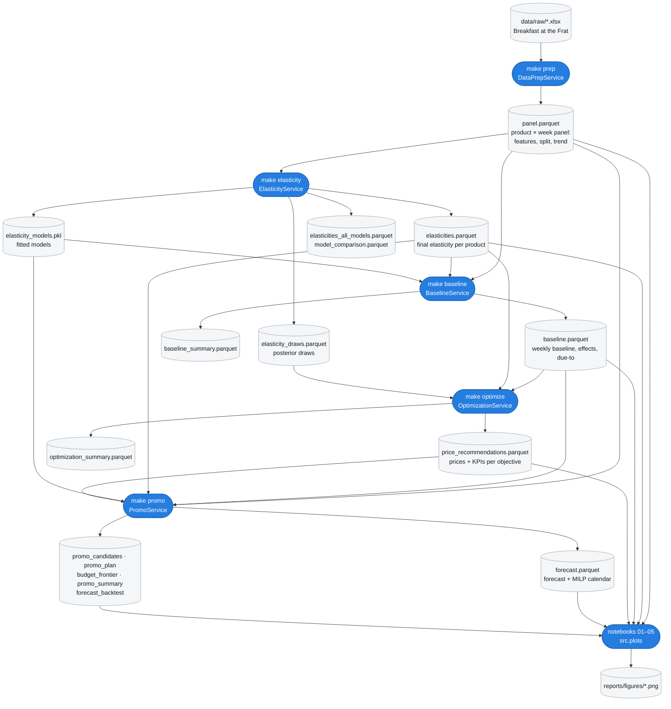

# Architecture

How the code is organised, how data flows between stages, and how to extend it. The coding conventions are in
[`.claude/skills/python-style/SKILL.md`](../.claude/skills/python-style/SKILL.md).

## Data flow

Rounded boxes are pipeline stages (`make <stage>` → the layer's facade); cylinders are files in `data/processed/`
unless noted. Arrows show every input a stage reads.



Every stage reads its inputs from `data/processed/` and writes its outputs there, so any stage can be re-run on its
own. The raw Excel file is parsed once and cached as `raw_*.parquet`.

## Package layout

```
src/
  config.py        frozen pydantic Config (Config.load), Enums for fixed choices, project paths
  schema.py        Col: every column name; Split, FilterReason, ImputeReason, Tactic; fourier_columns
  pipeline.py      Stage registry + PipelineCli (python -m src.pipeline <stage>)
  utils/           logger.py (AppLogger) · exceptions.py (RPOError hierarchy) · registry.py (Registry)
  prep/            loader.py · panel.py · features.py · trend.py · service.py
  elasticity/      base.py · frequentist.py · bayes.py · guardrails.py (QualityGates, ModelSelector,
                   HierarchicalImputer) · service.py
  baseline/        effects.py · rules.py · decomposition.py · service.py
  optimization/    inputs.py · demand.py · problem.py · solver.py · robustness.py · service.py
  promo/           forecasters.py (naive, seasonal, SARIMAX, XGBoost) · forecast.py · candidates.py ·
                   planner.py (MILP, greedy, last year) · frontier.py · service.py
  plots/           style.py (PlotStyle, FigureStore) · eda.py · elasticity.py · baseline.py · optimization.py ·
                   promo.py
notebooks/         thin presentation notebooks (no logic)
tests/             mirrors src/ (one test class per production class)
```

A folder exists only when it holds two or more modules of the same kind; a lone module stays a single file.

## Layers and facades

Each layer exposes one facade, built by a factory (the composition root):

| Layer | Facade | Factory | Used by |
|---|---|---|---|
| `src.prep` | `DataPrepService.run()` | `DataPrepFactory(cfg, loader_settings, output_path)` | `PrepStage` |
| `src.elasticity` | `ElasticityService.run(panel)` | `ElasticityFactory(cfg, outputs)` | `ElasticityStage` |
| `src.baseline` | `BaselineService.run(panel, final)` | `BaselineFactory(cfg, models, outputs)` | `BaselineStage` |
| `src.optimization` | `OptimizationService.run(baseline, final, draws)` | `OptimizationFactory(cfg, outputs)` | `OptimizeStage` |
| `src.promo` | `PromoService.run(panel, baseline, final, recommendations)` | `PromoFactory(cfg, models, outputs)` | `PromoStage` |

Dependencies are injected through `__init__`. Only factories and pipeline stages construct objects, which is why
tests can swap in temporary paths and small synthetic data. Lower layers never import higher ones: prep knows
nothing about elasticity, baseline uses elasticity only through its facade
(`ElasticityModel`, `ModelStore`), and none of them imports the pipeline.

## Extension points (Open/Closed)

New behaviour is added by registering a class, not by editing an `if/elif` chain:

| Registry | Base class | Key | Add a new… |
|---|---|---|---|
| `AGGREGATORS` (`prep/panel.py`) | `Aggregator` | `Grain` | panel grain |
| `PRODUCT_FILTERS` (`prep/panel.py`) | `ProductFilter` | `FilterReason` | eligibility rule |
| `FEATURE_STEPS` (`prep/features.py`) | `FeatureStep` | name | engineered feature |
| `ELASTICITY_MODELS` (`elasticity/base.py`) | `ElasticityModel` | `ModelName` | elasticity model |
| `BASELINE_RULES` (`baseline/rules.py`) | `BaselineRule` | name | bad-baseline rule (with its fix) |
| `DEMAND_CURVES` (`optimization/demand.py`) | `DemandCurve` | `DemandForm` | demand curve (value + slope) |
| `OBJECTIVES` (`optimization/problem.py`) | `ObjectiveFn` | `Objective` | objective (value + gradient) |
| `CONSTRAINTS` (`optimization/problem.py`) | `Constraint` | name | pricing constraint (`fc ≤ 0` + Jacobian) |
| `FORECASTERS` (`promo/forecasters.py`) | `Forecaster` | `ForecastMethod` | baseline forecast method (scored in the backtest) |
| `PLANNERS` (`promo/planner.py`) | `PromoPlanner` | `Planner` | promo calendar planner (MILP, greedy, …) |
| `STAGES` (`pipeline.py`) | `Stage` | `StageName` | pipeline stage |

For example, to add an elasticity model:

1. Add a member to `ModelName` in `src/config.py`.
2. Subclass `ElasticityModel`, implement `fit` and `predict`, and decorate the class with
   `@ELASTICITY_MODELS.register`.
3. List the model under `elasticity.models` in `config/config.yaml`.

The service, quality gates, holdout comparison and forest plots pick it up automatically. To make the new model
eligible for selection, also add it to `elasticity.model_priority`.

## Configuration

All tunables live in `config/config.yaml` and are validated on load:

- **Data:** sheet and column mappings, grain.
- **Prep:** filters, holdout length, Fourier order, promo-flag thresholds, pantry lags, LOESS window.
- **Elasticity:** regular and promo bounds, models, model priority, quality gates, imputation levels, priors,
  sampler settings.
- **Optimization:** objectives, demand form, constraints, NLopt settings, price endings.
- **Forecast and promo:** horizon, forecast method (`auto` = backtest winner), SARIMAX order, XGBoost settings, lift model, tactics, depths, assumed fees, budget, calendar rules, frontier
  points, hurdle, MIP gap.

Config objects are frozen. Invalid values fail at load time, for example positive elasticity bounds or a priority
model that is not fitted.

## Errors and logging

- All project errors derive from `RPOError` (`ConfigError`, `MissingFileError`, `DataValidationError`,
  `SolverError`).
  `PipelineCli` turns them into a logged message and exit code 1.
- Logging goes through `AppLogger`; there are no `print` calls in `src/`. `logger.print()` pretty-prints shapes and
  parameters when `RPO_PRINT_ENABLED=true` in `.env`. Logs never contain data rows.

## Quality gates

`make check` runs ruff (lint and format), mypy, pytest and the pre-commit hooks, which include stripping notebook
outputs. CI runs the same checks on every pull request into `main`.
